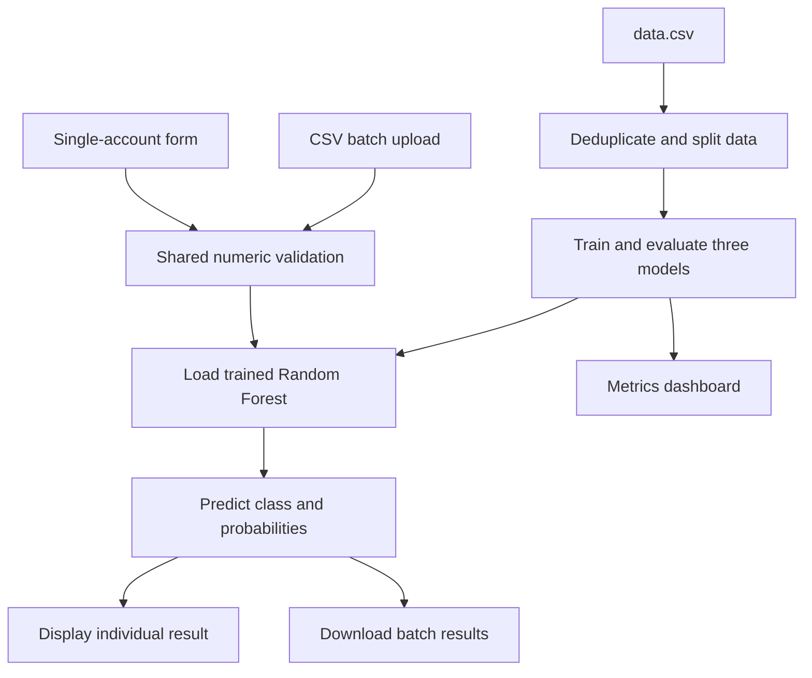

# Fake-Social-Media-Account-Detection
Account Lens — Fake Social Media Account Detection
A Flask machine learning application that screens numeric account statistics and predicts Likely fake or Likely genuine. It supports single-account checks, CSV batch predictions, and a dashboard comparing three trained classifiers.

Predictions are estimates based on account features, not proof of identity or account authenticity. The application does not fetch live social media profiles.
Dashboard Preview
Upload your dashboard image to images/dashboard.png in your GitHub repository, then uncomment this Markdown line:

A generated preview is a design mockup, not a screenshot of the running application.
Features
- Enter and validate 11 numeric account features.
- Predict a class using the saved Random Forest model.
- Display model confidence and fake-class probability.
- Upload CSV files for batch screening and download results.
- Download a sample CSV with the required feature headers.
- Compare Random Forest, Decision Tree, and Logistic Regression metrics.
- Display a Random Forest confusion matrix and global feature importance.
- Preview the first 100 rows of the original dataset.
- Show helpful errors for missing or incompatible models, missing metrics, and oversized uploads.
Technology Stack
Component	Implementation
Backend	Python and Flask
Interface	Jinja HTML templates and CSS
Data handling	pandas and NumPy
Machine learning	scikit-learn
Prediction model	RandomForestClassifier, 200 trees
Comparison models	DecisionTreeClassifier; StandardScaler + LogisticRegression
Model storage	Local pickle .sav files
Metrics storage	model_metrics.json
Tests	Python unittest with Flask test client

No login, database, social media API integration, or live profile verification is implemented. The app does not require an LLM API key.
Workflow

Training is a separate command. The app loads saved models for inference; it does not retrain on each request.
Input Features
CSV column names must match the following headers exactly. The validator selects them in the model's required order.
CSV header	Meaning	Accepted values
profile pic	Profile picture indicator	0 or 1
nums/length username	Username digit ratio	Number from 0 to 1
fullname words	Full-name word count	Nonnegative integer
nums/length fullname	Full-name digit ratio	Number from 0 to 1
name==username	Name matches username indicator	0 or 1
description length	Bio length	Nonnegative integer
external URL	External URL indicator	0 or 1
private	Private account indicator	0 or 1
#posts	Post count	Nonnegative integer
#followers	Follower count	Nonnegative integer
#follows	Following count	Nonnegative integer

Training labels use fake: 0 = genuine, 1 = fake. Dataset collection and labelling provenance are not documented; validate feature construction against the original data source before applying the model elsewhere.
Validation Rules
- Required feature columns must be present.
- CSV header names must be unique.
- Values must be numeric and finite; blanks, NaN, and infinity are rejected.
- Binary values must be 0 or 1.
- Ratios must be between 0 and 1 inclusive.
- Counts must be nonnegative whole numbers.
- Values beyond the float32 range are rejected.
- Batch input must contain 1–10,000 accounts.
- Flask limits the entire request body to 2 MiB, including multipart overhead.
Dataset and Training
train_model.py reads data.csv. dataset.csv is included as a historical file and is not the active training source.

The training script:
1. Removes exact duplicate rows.
2. Validates feature values and labels.
3. Rejects identical feature rows with conflicting labels.
4. Performs a stratified 70/30 train/test split with random_state=42.
5. Trains a 200-tree Random Forest and a Decision Tree, each using seed 42.
6. Trains Logistic Regression after StandardScaler, with max_iter=2000 and seed 42.
7. Evaluates all three models on the held-out test set.
8. Saves model files and model_metrics.json.
Before the first overwrite, existing model artifacts are backed up as .legacy.sav files if those backups do not already exist. Writes use temporary files before replacement.
Recorded Evaluation Results
These values are taken from the supplied model_metrics.json; they were not reproduced during this review. Its dataset SHA-256 matches the included data.csv.
Dataset item	Count
Original rows	696
Duplicate rows removed	4
Unique accounts	692
Training accounts	484
Test accounts	208
Genuine labels after deduplication	347
Fake labels after deduplication	345

Model	Accuracy	Precision: fake	Recall: fake	F1: fake
Random Forest	93.75%	95.05%	92.31%	93.66%
Decision Tree	90.87%	90.48%	91.35%	90.91%
Logistic Regression	91.35%	96.74%	85.58%	90.82%

The web application uses Random Forest for predictions; the other two models support comparison.
Random Forest Confusion Matrix
Rows represent actual labels; columns represent predicted labels.
Actual / Predicted	Genuine	Fake
Genuine	99	5
Fake	8	96

The top recorded global feature importances are posts (25.87%), followers (24.82%), username digit ratio (13.38%), following count (9.44%), and bio length (9.17%). These describe the fitted forest globally; they do not explain an individual prediction or establish causality.

Performance describes one dataset and split. It does not establish accuracy across platforms or real-world accounts. Model probabilities are uncalibrated; a displayed confidence is not a verified probability that the account is authentic.
Project Structure
The supplied ZIP contains two nested directories with the same project name. Run commands from the inner directory containing app.py.
project/
├── app.py
├── features.py
├── train_model.py
├── test_app.py
├── data.csv
├── dataset.csv
├── Random_forest.sav
├── Decision_tree.sav
├── Logistic_Regression.sav
├── model_metrics.json
├── fake_account.ipynb
├── requirements.txt
├── Procfile
├── README.md
├── PROJECT_REVIEW.md
├── templates/
│   ├── base.html
│   ├── index.html
│   ├── prediction.html
│   ├── dashboard.html
│   ├── batch.html
│   ├── view.html
│   ├── about.html
│   └── error.html
└── static/
    ├── css/
    ├── images/
    └── js/
Legacy backups and additional historical HTML/assets are also present. Active routes use the shared base template; the existence of older templates does not imply active routes for those pages.
Setup and Run
Prerequisites
- A Python interpreter compatible with the pinned dependencies.
- pip and a fresh virtual environment.
- The included data.csv for retraining.
The supplied requirements pin specific versions. A clean installation of these pins was not verified in this review. If your package index or Python version cannot satisfy them, resolve a compatible dependency set and retrain all models in that environment rather than mixing scikit-learn versions.
Windows PowerShell
python -m venv .venv
.\.venv\Scripts\python.exe -m pip install -r requirements.txt
.\.venv\Scripts\python.exe train_model.py
.\.venv\Scripts\python.exe app.py
macOS / Linux
python3 -m venv .venv
source .venv/bin/activate
python -m pip install -r requirements.txt
python train_model.py
python app.py
Open http://127.0.0.1:5000.

Retraining creates models matched to the installed scikit-learn version. The app explicitly rejects version-inconsistent Random Forest artifacts and unexpected model schemas. It refreshes its cached predictor when the model file's modification timestamp changes.

Only load trusted pickle files: loading a pickle can execute code. Training locally produces your own replacement artifacts.
Supplied Dependency Pins
flask==3.1.3
pandas==3.0.6
numpy==2.5.3
scikit-learn==1.9.1
joblib==1.6.0
gunicorn==26.2.0
The app itself uses Python pickle for model loading. Jupyter is not included by these requirements; install it separately if you want to open the notebook.
Using the Application
Single-Account Check
1. Open Check account.
2. Enter all 11 feature values, or use the sample input control.
3. Submit the form.
4. Read the estimated class, model confidence, and fake-class probability.
Confidence is max(predict_proba) expressed as a percentage; fake-class probability is the probability assigned to label 1. Do not treat either as proof of misconduct.
CSV Batch Check
1. Open Batch check.
2. Download the sample CSV.
3. Add rows using the exact required headers.
4. Upload a CSV within the size and row limits.
5. Download account_predictions.csv.
The result adds these columns:
- prediction
- confidence_percent
- fake_probability_percent
Extra input columns are preserved, except existing columns with these three reserved output names are overwritten.
Dashboard and Dataset
The dashboard reads recorded evaluation metrics from JSON; these are not live counts of user submissions. The dataset view displays the first 100 original rows, including any duplicates present in the source CSV.
Actual Routes
Route	Methods	Purpose
/	GET	Home page
/about	GET	Project explanation
/prediction	GET, POST	Single-account input and result
/dashboard	GET	Model evaluation dashboard
/model	GET, POST	Dashboard alias
/batch	GET, POST	CSV upload and results download
/batch/sample	GET	Sample CSV download
/view	GET	First 100 dataset rows

These routes serve HTML/forms or CSV; no dedicated JSON prediction API is implemented.
Tests and Verification
Run the existing regression suite from the project directory after installing dependencies and training models:
python -m unittest -v test_app
The included suite defines 12 tests covering page rendering, prediction inputs, invalid numeric values, batch results, duplicate headers, row and upload limits, missing artifacts, internal links/assets, and agreement between saved-model accuracy and recorded metrics.

This review: Python syntax parsing passed; CSV row counts and the recorded dataset hash were checked. Flask is absent from the review environment, so the Flask tests and live application were not run. Bundled pickle models were not loaded. The reported metrics remain supplied results rather than newly measured results.
Limitations
- Manual numeric inputs and CSV data; no social API integration or automatic profile scraping.
- Small dataset with undocumented collection and label provenance.
- One held-out split; no cross-validation, external-platform evaluation, or probability calibration is implemented.
- No login, role controls, database persistence, or audit history.
- No user-submission analytics: dashboard counts describe the training dataset.
- Global feature importance does not explain a specific prediction.
- Flask's built-in server is for local development. Production hosting requires appropriate server and security configuration.
- Existing legacy assets remain and may need cleanup before publishing.
Future Improvements
- Document dataset origin, permissions, feature extraction, and labelling.
- Add cross-validation and independent external evaluation.
- Evaluate and calibrate predicted probabilities.
- Add local explanations with clear limitations.
- Provide a versioned JSON prediction API.
- Add authentication and submission history if required.
- Add accessibility checks and more deployment validation.
Attribution and License
The supplied interface credits the original project to Balaram Panigrahy. Preserve original attribution and add your own contributions accurately.

No project-level license file was found among the inspected files. Confirm reuse and redistribution permissions before publishing; do not assume a license from the presence of source code.
